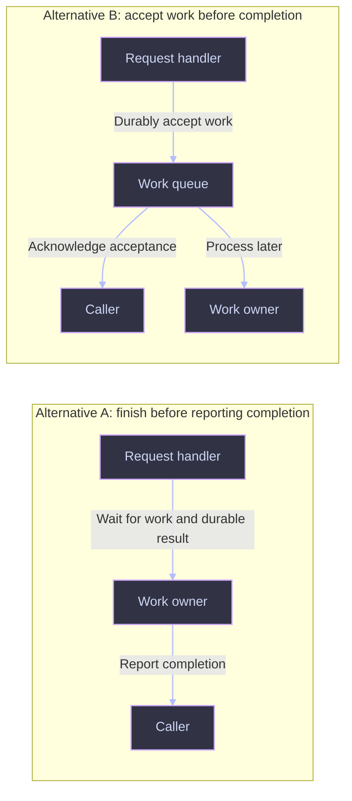

# Architecture design during grilling

Research date: 2026-11-02.

This note explains when an AI interview should expand into architecture design before `/skill:to-spec`. It is research and a proposed local decision policy, not a workflow change or an implementation specification. The goal is shared understanding of consequential choices, with visual alternatives and trade-offs. Implementing agents retain ownership of signatures and coding details.

## Recommended decision boundary

> Assess every change for architectural significance. Expand grilling into design only when a consequential architecture choice remains unsettled and proceeding would commit implementation to an unagreed structure, contract, or quality trade-off.

> If existing decisions and patterns settle that choice, cite them and continue. If facts are missing, gather the facts before treating uncertainty as a design fork.

This is a proposed local policy. The publications below support its distinctions, but none prescribes this workflow or a universal threshold for architectural significance.

The policy separates three questions that are easy to conflate:

- Does the change affect something architecturally significant?
- Is a consequential choice about that effect still open?
- Does the choice need agreement before dependent implementation proceeds?

A significant change can need careful implementation without a new design discussion. A decision can also be architecturally significant without being difficult to reverse. The need for shared agreement, rather than file count or irreversibility alone, determines whether this interview expands.

## What the primary sources establish

### Architecture concerns relevant structure and observable properties

The SEI definition compilation reproduces the definition from *Documenting Software Architectures: Views and Beyond*, second edition. Architecture is the structures needed to reason about a system, including elements, relationships, and their properties. Its discussion of *Software Architecture in Practice*, second edition, distinguishes externally visible properties from private implementation details. Those properties include performance, fault handling, and shared resource use, not just callable operations. Behavior matters when it changes how another element must interact or whether the system as a whole is acceptable. [S1, pages 1–2](https://www.sei.cmu.edu/documents/2544/2010_010_001_513810.pdf)

For this workflow, the useful distinction is between a choice that changes shared assumptions and a choice hidden inside an already agreed contract. Physical size is not the distinction. One module can control a system-wide guarantee, while a mechanical change can touch many files without changing any guarantee. This application of the source is a local inference, not the SEI's proposed interviewing procedure.

### Significance depends on the system and its stakeholders

In *Who Needs an Architect?*, Martin Fowler discusses Ralph Johnson's account of architecture as the developers' shared understanding of important design. Fowler contrasts the importance of persistence in enterprise applications with its potentially minor role in medical imaging. His later *Software Architecture Guide* repeats that determining what matters is central to architectural thinking. [S2, pages 1–2](https://martinfowler.com/ieeeSoftware/whoNeedsArchitect.pdf), [S3, “What is architecture?”](https://martinfowler.com/architecture/)

This supports a contextual assessment, not a universal list of technologies that always demand design. “Database,” “security,” “new module,” and “performance” name subjects to inspect. They do not establish that the user faces an unsettled architectural choice.

Fowler also examines architecture as decisions people perceive as hard to change. His schema-migration example shows that engineering can reduce that difficulty. He does not establish irreversibility as a necessary condition for every important decision. [S2, pages 2–3](https://martinfowler.com/ieeeSoftware/whoNeedsArchitect.pdf)

For the proposed policy, reversal cost is evidence of consequence. It is neither a mandatory condition nor a reason to ignore security, correctness, or operational consequences that arise before a reversal.

### Quality requirements need concrete scenarios

Bachmann, Bass, and Klein's SEI report distinguishes general scenarios from system-specific concrete scenarios. Section 2.1 gives six parts: the stimulus, its source, the environment, the stimulated artifact, the response, and the response measure. The report connects those requirements to architectural tactics and design fragments. [S4, section 2.1, printed pages 5–6](https://sei.cmu.edu/documents/704/2003_005_001_14213.pdf)

For an interview, this suggests asking what happens, under which conditions, to which part of the system, and what outcome counts as acceptable. “It must scale” does not yet identify a useful choice. A known workload, a required response, or a reasoned failure scenario can do so. Measurements and limits must come from the project or the user, not from an invented threshold.

The six-part scenario is a reasoning aid here, not a required form for every change. A clear requirement that acknowledged writes survive a process crash can identify a durability obligation without an arbitrary numerical target.

### Significant decisions need rationale, not exhaustive specifications

Michael Nygard's original architecture decision record article identifies decisions affecting structure, non-functional characteristics, dependencies, interfaces, or construction techniques as architecturally significant. Each record captures context, one decision, status, and consequences. The article explicitly says that not all decisions occur at project start and allows decisions to be superseded. [S5, “Decision” and “Consequences”](https://cognitect.com/blog/2011/11/15/documenting-architecture-decisions)

This is a useful classification of subjects and a model for preserving why a choice was made. It does not mean every interface edit requires an interview or an ADR. That filtering rule would be our policy, not Nygard's. This research creates no ADR.

## Terms for the interview

These are proposed working meanings for this decision boundary, not new glossary entries.

**Architecture-significant choice.** A design choice whose consequences matter to the system's organization, shared contracts, ability to meet an important quality requirement, or construction and operation. Its importance is explained through an affected requirement, shared assumption, or dependency, not asserted through the word “architecture.”

**Consequential unsettled choice.** An architecture-significant choice that existing decisions, requirements, and applicable patterns do not already settle. Plausible alternatives produce a difference the user or responsible stakeholders need to understand before implementation commits to one. If the constraints permit only one viable approach, an unagreed consequence can still need explanation and agreement. There is no reason to invent another candidate.

**Implementation detail.** A choice that the implementing agent can make within agreed responsibilities, contracts, and quality constraints, without changing another module's assumptions or the agreed outcomes. “Private” is a claim about effects, not visibility keywords. A private function that determines tenant isolation is not automatically an implementation detail.

**Architecture assessment.** The brief determination of whether a consequential unsettled choice exists. Every change gets an assessment, but most need no separate design artifact. The assessment can cite the applicable pattern and say that no new architecture choice remains.

**Architecture design discussion.** The proportionate explanation and comparison needed to settle an identified choice. It produces agreed responsibilities, interactions, constraints, trade-offs, and rationale. It does not require code-shaped sketches.

The local [codebase-design vocabulary](../../plugin/skills/codebase-design/SKILL.md#glossary) already provides the terms *module*, *interface*, and *seam*. A module is scale-independent. An interface includes invariants, ordering, failures, configuration, and performance properties. A seam is where behavior can vary. Those meanings support high-level contracts without prescribing signatures. Source terminology such as C4 “component” retains its source-specific meaning and is not a replacement for the local term *module*.

## When assessment should expand into design

The following are candidate triggers, not independent mandatory checkboxes. A trigger becomes a design discussion when its consequence is important, unsettled, and needed before dependent implementation.

- Responsibility or ownership could move between modules. Alternatives change who owns a rule, lifecycle, or source of truth, or reverse a dependency direction.
- A shared contract is open. Alternatives change ordering, consistency, compatibility, failure behavior, or what other modules and external consumers may assume.
- A trust or data-lifecycle choice is open. Alternatives change who may act, where authorization is enforced, what persists, what is acknowledged as durable, or how existing data remains usable.
- A runtime or operational choice is open. Alternatives change process placement, concurrency, deployment, failure isolation, recovery responsibilities, or an external dependency that operators must support.
- A quality requirement creates a meaningful trade-off. Evidence or a credible scenario links the requirement to competing designs with different security, availability, latency, resource, or maintenance consequences.
- The work conflicts with an existing decision or pattern. Following it and departing from it have materially different consequences that the current requirements do not settle.

A useful explanation connects the effect to the decision: “Acknowledging the request before durable storage changes what success means after a crash. We have not agreed whether that is acceptable.” That is more defensible than “This touches persistence, so we need architecture.”

Hard-to-reverse data changes, external commitments, and coordination costs strengthen the case for early agreement. Easy reversal does not remove an immediate data-loss or security consequence. Conversely, choosing a hard-to-reverse identifier may need careful product agreement without requiring a comparison of system structures.

### When assessment can stop without design

The proposed policy skips expansion when the evidence shows that:

- An applicable decision or established pattern settles the significant choice, and the new use preserves its assumptions.
- The change alters no agreed responsibility, interaction, shared guarantee, or important quality constraint.
- Remaining choices are internal coding choices within those constraints.
- A rename, generated update, or other mechanical edit preserves behavior and contracts, even across many files.
- The uncertainty concerns repository facts rather than competing designs. The next useful action is a source read or a bounded investigation.

“Skip design” does not mean “skip requirements, risk assessment, or implementation verification.” It means that another architecture comparison would add no decision value.

## Concrete examples

These examples illustrate the proposed policy. They are not claims about defects or requirements in this repository.

| Change | Assessment and reason |
|---|---|
| A single authorization module may either trust a caller-supplied tenant identifier or derive tenant identity from authenticated context. | Expand if the trust model is unsettled. The code may fit in one file, but the choice changes tenant isolation and what every caller may assume. Reversal cost is not the deciding factor. |
| A single persistence module may acknowledge success before or after its storage operation becomes durable. | Expand if durability expectations are unsettled. A crash scenario distinguishes the alternatives even without adding modules or changing signatures. |
| A persistence module receives a new field using the established additive migration pattern. Existing compatibility and retention rules apply unchanged. | Skip expansion after citing that pattern and checking that its assumptions hold. Persistence is involved, but the architecture choice is already settled. |
| A mechanical symbol rename updates many files and callers without changing responsibilities or behavior. | Skip expansion. File count measures edit spread, not architectural significance. |
| A feature adds another report through an existing report module, renderer, and storage pattern. It preserves the same failure and access rules. | Skip expansion after grounding that fit. A new user-visible capability does not by itself introduce a new architecture fork. |
| A developer proposes a distributed cache because the feature “may need to be fast.” There is no workload, target, measurement, or credible bottleneck analysis. | Do not treat the cache as a necessary architecture decision. Clarify the performance requirement and gather relevant evidence. If nothing establishes a need, retain the existing design rather than invent a scalability problem. |
| A new latency requirement conflicts with measured behavior of the current synchronous path. A background job changes completion semantics, while a synchronous alternative increases resource cost. | Expand. The evidence connects an actual quality requirement to a trade-off the user needs to understand. |
| A performance requirement exists before code or measurements do. A documented workload and external deadline make the current proposed design's capacity assumptions questionable. | Assess through analysis or a bounded experiment. Lack of production measurements does not invalidate a credible requirement. Expand when that evidence exposes an unsettled design trade-off. |
| Greenfield work can run as a local tool or a hosted multi-user system. Ownership, persistence, and operational expectations differ. | Expand around those consequences. No existing implementation is needed for architectural significance. Establish the relevant context rather than forcing an investigation of nonexistent code. |
| A greenfield single-user utility has agreed local-only behavior and no durable state. A standard project pattern supplies its structure. | Assess, then skip a larger design exercise if that pattern satisfies the actual requirements. “Greenfield” does not mandate services, layers, or diagrams. |
| An agent extracts a private helper inside a module while preserving its interface and quality constraints. | Leave the extraction to implementation. Expand only if inspection reveals that the supposed helper takes on a shared responsibility or changes an important guarantee. |
| A provider replacement conforms to an existing interface but changes data residency or outage behavior. | Treat the operational or data consequence as significant. Compare it if unsettled. Matching method signatures does not establish equivalence. |

## Missing evidence is not an automatic architecture exercise

An interviewer should distinguish an unknown fact from an undecided preference or trade-off. “We have not read the persistence code” calls for grounding. “Both approaches satisfy the data rules but assign recovery to different operators” identifies a decision.

Evidence need not be a production benchmark. Relevant evidence can include existing code and tests, accepted decisions, an incident, a contractual obligation, a threat scenario, or a quality-attribute analysis. A proposal that simply names a possible future problem is weaker than evidence that connects a real requirement to the proposed change.

When missing information could change the recommendation, the useful record states the unknown, why it matters, and what observation or stakeholder answer would resolve it. An explicit assumption must remain an assumption, not become user agreement. Bounded investigation can resolve a capacity question. A user answer can establish acceptable data-loss behavior. Neither requires designing an entire future system first.

If a consequential choice still lacks its deciding fact, it remains open. Do not manufacture confidence, choose a consequential default silently, or expand unrelated parts of the design to compensate. Unaffected decisions can continue. A deferred decision is legitimate only when dependent work can avoid committing to it and the reason for reopening it is explicit.

## Proportionate visual design

Simon Brown's C4 model separates system context, containers, components, and code. Its overview says to use only levels that add value. Context and container diagrams suffice for most teams. C4's code level is optional and discouraged for long-lived documentation. [S6](https://c4model.com/diagrams), [S8](https://c4model.com/diagrams/code)

For this interview, the proposed policy is to draw the smallest view that makes the actual choice understandable:

- A context view explains affected actors, external systems, and trust relationships.
- A module responsibility and dependency sketch explains competing ownership or seam placement. It need not be a formal C4 diagram.
- A container view explains separately running applications and data stores. In C4, “container” does not mean only a Docker container. [S7](https://c4model.com/diagrams/container)
- A dynamic or sequence view explains ordering, acknowledgment, failure, or recovery when a static sketch would conceal the difference. C4 recommends dynamic diagrams sparingly for interactions that warrant them. [S9](https://c4model.com/diagrams/dynamic)
- A deployment view explains environment-specific placement, replication, or isolation when those are the choice. A container view alone does not communicate those deployment details. [S7](https://c4model.com/diagrams/container), [S10](https://c4model.com/diagrams/deployment)

Compare alternatives at the same abstraction level. Name responsibilities, label dependency or data-flow arrows, and state what each alternative gains and gives up against the same constraints. A smaller change may need only a sketch and a paragraph. A consequential fork may need alternative views and a comparison. There is no required diagram count or complete C4 suite.

The following invented example illustrates the appropriate level. It compares completion semantics, not function declarations or a proposed implementation for this repository.

Alternative A makes request completion correspond to finished work, but the caller waits for that work. Alternative B separates acceptance from completion and requires an agreed way to observe the final outcome. Its queue and worker also introduce recovery responsibilities. These are semantic and operational differences, not evidence that either design is faster or more reliable. That claim would need further analysis.

A diagram does not establish durability or failure guarantees by itself. The accompanying prose must state what is promised, what happens on failure, and which assumptions remain unproven.

## What stays with implementing agents

The design agreement should establish enough to prevent agents from making incompatible consequential choices:

- Module responsibilities, ownership, dependency direction, and any necessary seam.
- Observable semantics, including the relevant invariants, ordering, failure behavior, and data guarantees.
- Important operational constraints and the quality requirements that distinguish the alternatives.
- The chosen direction, its rationale, rejected alternatives when relevant, and unresolved assumptions.
- High-level behavior and test seams that demonstrate those guarantees.

Implementing agents should normally choose private decomposition, function and method signatures, local types, file layout, ordinary algorithms, and test mechanics within that agreement. Signatures are not intrinsically trivial. A published compatibility contract or a type that encodes an agreed security rule may need precision. The exception follows the consequence, not a rule that design must always contain code.

If implementation reveals that the agreed guarantees cannot coexist, the agent should return the consequential choice for reconsideration. It should not silently change the contract or require human approval for every parameter adjustment.

## Fit with the existing Matt flow and pstack architect

The current [grill-with-docs entry](../../plugin/skills/grill-with-docs/SKILL.md) uses grilling for the interview and domain-modeling for glossary or ADR work. [Grilling](../../plugin/skills/grilling/SKILL.md) already organizes decisions by prerequisites and requires repository facts to come from tools rather than from the user. Its shared-understanding objective is a suitable home for this proposed assessment and any consequential design discussion.

The [local rejection of pstack architect](../../decision-register.yaml#L280-L287) says that grill-with-docs and Design It Twice already cover design in the Matt flow. [Design It Twice](../../plugin/skills/codebase-design/DESIGN-IT-TWICE.md) already compares structurally different interfaces, dependencies, and trade-offs. It is more code-shaped than the visual, high-level discussion desired here. Its current candidate counts and output requirements should not be misreported as a lightweight conditional assessment that already exists.

At upstream commit `e73df471cd4bd918367e99f3dd9c51bd53ddf5f0`, [pstack architect](https://github.com/cursor/plugins/blob/e73df471cd4bd918367e99f3dd9c51bd53ddf5f0/pstack/skills/architect/SKILL.md) contributes useful ideas: ground the existing system, examine structurally different candidates, explain trade-offs, and reconsider a design when implementation contradicts its assumptions. Its default proceeds into implementation without a human checkpoint, and its sketches prescribe types and signatures. Those defaults do not fit this request. Borrowing its reasoning does not authorize importing its implementation phase, code scaffolds, model choices, or mandatory alternative generation.

The current [to-spec contract](../../plugin/skills/to-spec/SKILL.md) says to synthesize existing conversation rather than interview. It also explicitly asks for seam confirmation and, for changes spanning modules, a capability map of responsibilities, dependencies, and build order. Real module-split forks can enter that confirmation. Thus, “synthesis-only” is the intended division of work, not a claim that the current skill has no questions or design-related content.

The recommended division keeps consequential architecture discovery and agreement before to-spec. To-spec can express the agreed direction, arrange its capability map, and confirm high-level test seams without becoming a second architecture interview. A newly discovered consequential fork is a shared-understanding gap to resolve upstream, not an invitation to invent the decision in the spec. This is a proposed responsibility split. No skill, decision-register entry, glossary, or ADR changes in this research run.

## Limitations and open decisions

The sources offer definitions, experience reports, and reasoning methods. They do not provide an empirically validated classifier for AI interviews, nor do they establish a universal distinction between architecture and detailed design. SEI's compilation includes several definitions and an older standard's wording. This note does not claim conformance to that standard or substitute it for a current standards review.

The local policy requires judgment about consequences and who needs agreement. It has not been trialed against a representative set of this project's changes. The examples test its meaning conceptually, not its observed accuracy. The note has no numerical scoring threshold because the research does not justify one.

Repository observations describe the checked-out files on the research date. The upstream architect observation is pinned to the cited commit. Public documentation can change independently. No builds, tests, linters, formatters, or runtime checks were run. This assignment changes only this research note.

The remaining policy decisions are:

- Whether to adopt the proposed concise boundary and the term *architecture assessment*.
- Whether design discussion remains part of grill-with-docs or uses an explicit invoked helper while the interview retains decision ownership.
- How to present a no-expansion assessment without creating a separate artifact for routine changes.
- How an architecture discovery during to-spec returns to shared understanding while preserving the existing seam-confirmation contract.

These are local workflow choices for the parent discussion. The publications do not decide them.

## Primary sources

- **S1.** Carnegie Mellon Software Engineering Institute, *What is your definition of software architecture?* Definition compilation. Relevant passages are on pages 1–2. https://www.sei.cmu.edu/documents/2544/2010_010_001_513810.pdf
- **S2.** Martin Fowler, *Who Needs an Architect?* IEEE Software, July/August 2003. Relevant passages are on PDF pages 1–3. https://martinfowler.com/ieeeSoftware/whoNeedsArchitect.pdf
- **S3.** Martin Fowler, *Software Architecture Guide*, August 1, 2019. https://martinfowler.com/architecture/
- **S4.** Felix Bachmann, Len Bass, and Mark Klein, *Deriving Architectural Tactics: A Step Toward Methodical Architectural Design*, CMU/SEI-2003-TR-004, March 2003. Section 2.1 is on printed pages 5–6, PDF pages 17–18. https://sei.cmu.edu/documents/704/2003_005_001_14213.pdf
- **S5.** Michael Nygard, *Documenting Architecture Decisions*, November 15, 2011. https://cognitect.com/blog/2011/11/15/documenting-architecture-decisions
- **S6.** Simon Brown, C4 model, *Diagrams*. https://c4model.com/diagrams
- **S7.** Simon Brown, C4 model, *Container diagram*. https://c4model.com/diagrams/container
- **S8.** Simon Brown, C4 model, *Code diagram*. https://c4model.com/diagrams/code
- **S9.** Simon Brown, C4 model, *Dynamic diagram*. https://c4model.com/diagrams/dynamic
- **S10.** Simon Brown, C4 model, *Deployment diagram*. https://c4model.com/diagrams/deployment
